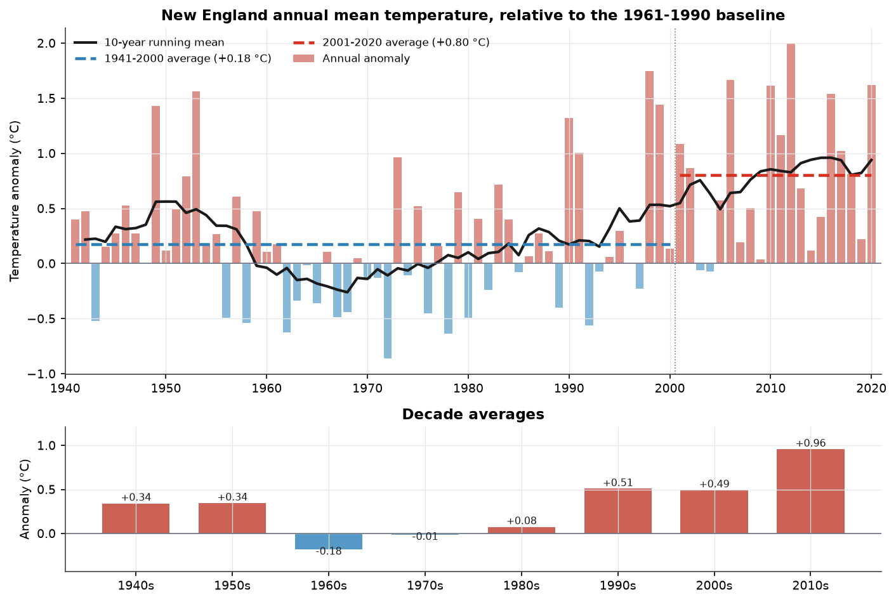
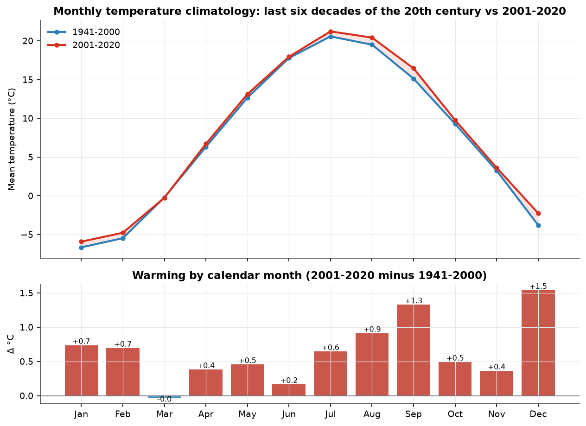
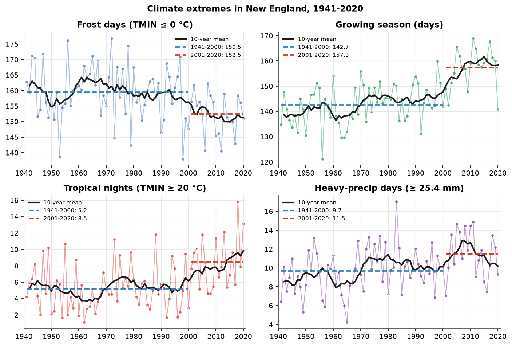
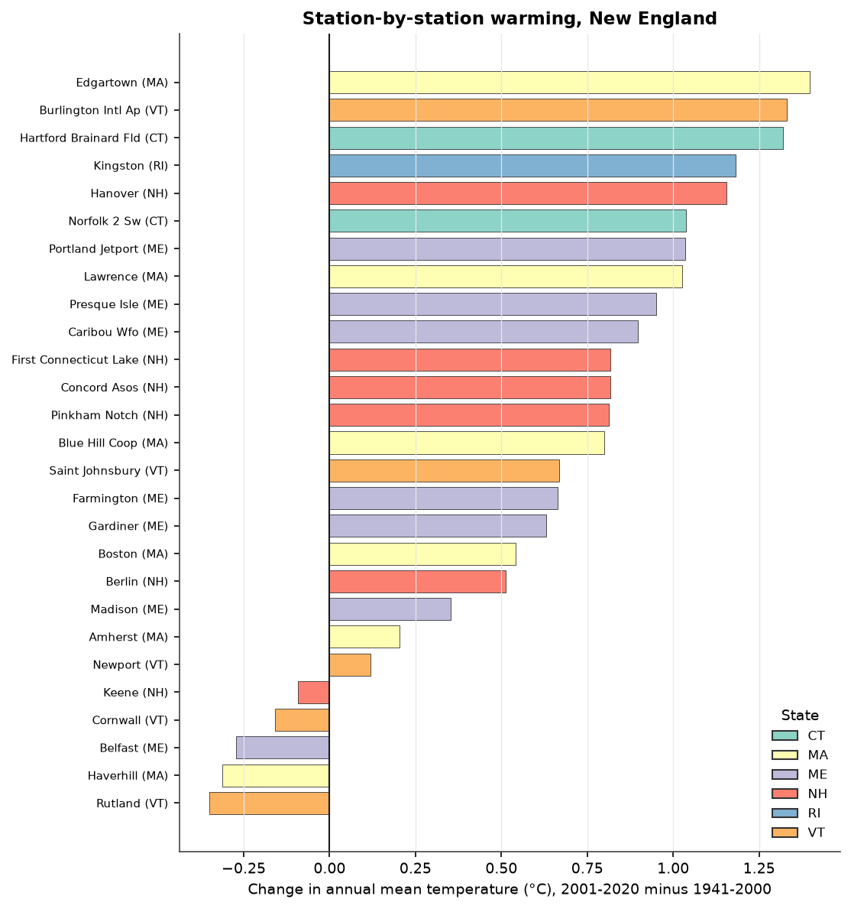
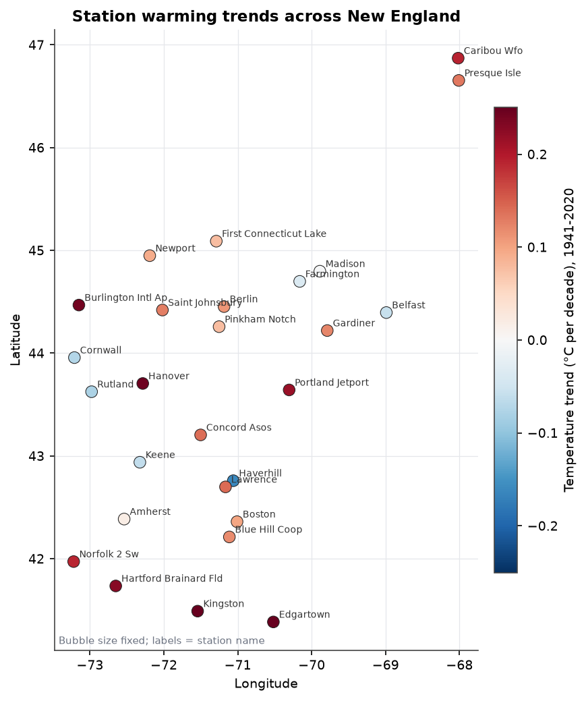
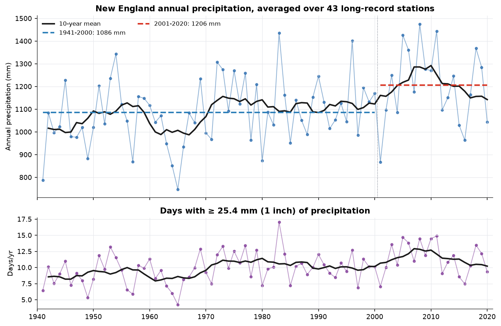

# New England climate: last six decades of the 20th century vs the first two of the 21st

An analysis of **GHCNd** daily station data for Connecticut, Rhode Island, Massachusetts,
Vermont, New Hampshire and Maine.

| | Period | Years |
|---|---|---|
| Era 1 | **1941–2000** | last 6 decades of the 20th century |
| Era 2 | **2001–2020** | first 2 decades of the 21st century |
| Baseline | **1961–1990** | WMO reference period, inside Era 1 |

Data: GHCNd version `3.35-upd-2026111517`, downloaded from
`https://www.ncei.noaa.gov/pub/data/ghcn/daily/` on 2026-11-19.

---

## Headline results

| Indicator | 1941–2000 | 2001–2020 | Change | Significant? |
|---|---:|---:|---:|---|
| Annual mean temperature | 7.44 °C | 8.07 °C | **+0.62 °C** | yes (p < 0.001) |
| Mean daily minimum | 1.62 °C | 2.51 °C | **+0.90 °C** | yes (p < 0.001) |
| Mean daily maximum | 13.25 °C | 13.62 °C | **+0.36 °C** | yes (p = 0.003) |
| Diurnal range (max − min) | 11.63 °C | 11.10 °C | **−0.53 °C** | yes (p < 0.001) |
| Frost days (min ≤ 0 °C) | 159.5 | 152.5 | **−7.0 days** | yes (p < 0.001) |
| Growing season length | 142.7 d | 157.3 d | **+14.7 days** | yes (p < 0.001) |
| Tropical nights (min ≥ 20 °C) | 5.2 | 8.5 | **+3.3 nights** | yes (p < 0.001) |
| Summer days (max ≥ 25 °C) | 70.7 | 76.0 | **+5.3 days** | yes (p = 0.001) |
| Hot days (max ≥ 30 °C) | 18.3 | 19.4 | +1.1 days | no (p = 0.20) |
| Annual precipitation | 1086 mm | 1206 mm | **+120 mm (+11 %)** | yes (p < 0.001) |
| Heavy-precip days (≥ 25.4 mm) | 9.7 | 11.5 | **+1.8 days (+19 %)** | yes (p < 0.001) |
| Annual snowfall | 171 mm | 177 mm | +5 mm | small (p = 0.014) |

**In one sentence:** New England's first two decades of the 21st century averaged
about **0.6–0.8 °C warmer** than the last six decades of the 20th century, with the
warming concentrated in **nights, winter and autumn**, a **two-week longer frost-free
season**, and **~11 % more precipitation** delivered in **more intense events**.

---

## 1. What was analyzed

GHCNd is a station archive, not a gridded product, so the analysis followed this chain:

1. **Candidate selection** (`src/00_select_stations.py`): all GHCNd stations in the six
   states whose inventory claims data spanning both eras → **94 stations**.
2. **Download** (`src/01_download.py`): the 94 `*.dly` files (167 MB) — no bulk archive.
3. **Parsing** (`src/02_parse.py`): 1941–2021, values flagged by GHCNd quality control
   removed, tenths converted to °C/mm → **9.93 million element-days** (27 MB Parquet).
4. **Indices + statistics** (`src/03_analyze.py`), **figures** (`src/04_plots.py`).

Station inclusion rules (deliberately conservative, so the station network does not
change between eras):

- A station-year counts only with **≥ 330 valid days** (~90 %) of temperature or
  precipitation.
- A station enters the temperature analysis with **≥ 50 of 60** valid years in Era 1
  **and ≥ 16 of 20** in Era 2 → **27 stations** (2 CT, 6 MA, 7 ME, 6 NH, 1 RI, 5 VT,
  median elevation 105 m, range 3–617 m).
- Precipitation analysis: 43 stations.
- Monthly/annual means are **equal-weight station averages**, with per-station anomalies
  computed against 1961–1990 before averaging. Significance = Wilcoxon signed-rank test
  on paired per-station era means.

The network is stable: 22–27 temperature and 30–43 precipitation stations report in any
given year, with no trend in station count.

---

## 2. Temperature



The regional annual mean rose from **+0.18 °C** (Era 1 average anomaly) to **+0.80 °C**
(Era 2). The linear trend over 1941–2020 is **+0.096 °C/decade** (Sen slope +0.084,
p = 0.002). Decade averages show the shape clearly:

| Decade | Anomaly (°C) |
|---|---:|
| 1940s | +0.34 |
| 1950s | +0.34 |
| 1960s | −0.18 |
| 1970s | −0.01 |
| 1980s | +0.08 |
| 1990s | +0.51 |
| 2000s | +0.49 |
| 2010s | **+0.96** |

The 2010s were the warmest decade in the 1941–2020 record; the 1960s the coldest.
(The 1940s bar covers 1941–1949 only.)
Of the 27 stations, **20 warmed and 18 of those significantly**; only 2 of the 7 cooling
stations are statistically significant (see caveats on Haverhill).

### Nights are warming about 2.5× faster than days

Minimum temperature rose **+0.90 °C** vs **+0.36 °C** for maximum temperature.
The diurnal temperature range narrowed by **0.53 °C** (p < 0.001, trend −0.10 °C/decade).
This is a well-known pattern: nighttime minima respond strongly to greenhouse warming
and are less affected by aerosol/solar effects on daytime clouds.

### Seasonality



| Season | 1941–2000 | 2001–2020 | Δ |
|---|---:|---:|---:|
| DJF | −5.30 °C | −4.30 °C | **+1.00** |
| MAM | 6.25 °C | 6.51 °C | +0.26 |
| JJA | 19.30 °C | 19.88 °C | +0.58 |
| SON | 9.22 °C | 9.93 °C | **+0.71** |

December (+1.54 °C) and September (+1.33 °C) warmed most; **March did not warm at all**
(−0.04 °C). In winter the signal is almost entirely at night: DJF minima +1.37 °C but
DJF maxima only +0.09 °C.

### Extremes and the growing season



- **Frost-free season +14.7 days** (143 → 157 d), and **100 % of stations** lengthened it.
  Both ends moved: the last spring frost came ~5.5 days earlier (11 May → 6 May) and the
  first autumn frost ~9 days later (1 Oct → 10 Oct).
- **Frost days −7.0/yr**, ice days −2.4/yr.
- **Tropical nights +3.3/yr** (5.2 → 8.5) — the largest relative change of any index.
- **Summer days +5.3/yr**, but **hot days (≥ 30 °C) +1.1/yr is not significant**
  (p = 0.20) and ≥ 90 °F days show no trend. Hot-day counts are noisy and depend on
  rare heat waves; the robust signal is in warm nights, not extreme daytime heat.

### Where the warming is strongest




| State | Stations | Era 1 | Era 2 | Δ |
|---|---:|---:|---:|---:|
| Rhode Island | 1 | 9.74 | 10.92 | **+1.18** |
| Connecticut | 2 | 8.55 | 9.82 | **+1.18** |
| New Hampshire | 6 | 6.15 | 6.75 | +0.67 |
| Massachusetts | 6 | 9.80 | 10.43 | +0.61 |
| Maine | 7 | 6.07 | 6.72 | +0.61 |
| Vermont | 5 | 7.16 | 7.52 | +0.32 |

Southern/coastal stations (Edgartown, Kingston, Hartford, Hanover, Burlington) warmed
most; northern/interior Vermont warmed least. This south–north gradient is consistent
with coastal warming and reduced winter cold outbreaks, though with 1–2 stations in the
small states the state numbers are indicative only.

---

## 3. Precipitation



| | 1941–2000 | 2001–2020 | Change |
|---|---:|---:|---:|
| Annual total | 1086 mm | 1206 mm | **+120 mm (+11 %)** |
| Wet days (≥ 1 mm) | 106.8 | 112.6 | +5.8 d |
| Days ≥ 25.4 mm | 9.7 | 11.5 | **+1.8 d (+19 %)** |
| Wettest day of year | 66.7 mm | 71.6 mm | +4.9 mm |

Precipitation increased in **all 43 stations** (median +124 mm) and heavy-precip days in
**98 %** of them. The trend is +25.6 mm/decade (p = 0.0005). The increase is larger in
relative terms for intense events (+19 %) than for the total (+11 %), i.e. the region is
getting wetter mostly through heavier events rather than more drizzle — wet-day counts
rose only 5 %.

Snowfall shows no meaningful change (+5 mm in the era means, but **no long-term trend**:
+0.2 mm/decade, p = 0.93; 67 % of stations slightly up and 33 % down). Warmer winters
shorten the snow season even where seasonal totals are unchanged; this dataset
(SNOW/SNWD) supports a dedicated snow-season analysis if wanted.

---

## 4. Robustness

The warming estimate does not depend on the completeness threshold:

| Selection rule (Era 1 / Era 2 years) | Stations | Mean Δ | Median Δ | % warming |
|---|---:|---:|---:|---:|
| 50 / 16 (main) | 27 | +0.63 | +0.80 | 81 % |
| 55 / 18 (strict) | 13 | +0.73 | +0.80 | 92 % |
| 45 / 15 | 37 | +0.67 | +0.80 | 84 % |
| 30 / 10 | 51 | +0.69 | +0.81 | 86 % |
| 5 / 5 (all stations) | 62 | +0.65 | +0.77 | 87 % |
| 1951–1980 vs 1991–2020 | 62 | +0.66 | +0.75 | 84 % |

So the regional warming is **+0.6 to +0.7 °C**, with a median station warming of ~0.8 °C.

---

## 5. Caveats

- **GHCNd is not homogenized.** Station moves, instrument changes and land-use change
  are not corrected. A single station can show a spurious trend — Haverhill, MA
  (−0.16 °C/decade) is the clearest example and drives some of the station spread.
- **Era 2 is only 20 years**, so it samples natural variability (ENSO, NAO, volcanic
  eruptions) more than Era 1 does. The *difference in means* is robust in sign and
  significance, but its exact size is uncertain by roughly ±0.2 °C.
- **Equal station weighting, not area weighting.** Coastal and low-elevation stations
  are over-represented relative to the land area (and relative to high terrain).
- **Precipitation gauge changes** (wind undercatch, tipping-bucket replacement) can
  produce artificial increasing trends, especially for heavy events. The +11 % should
  be read alongside independent gridded datasets before being treated as a pure climate
  signal.
- **Snow** is reported by fewer stations and has very high interannual variance; the
  snowfall comparison should be treated as descriptive.

None of these caveats overturn the main result: the sign, spatial consistency
(20 of 27 stations), seasonal pattern and statistical significance all agree.

---

## 6. Files and reproduction

```
src/00_select_stations.py   metadata -> candidate list      (94 stations)
src/01_download.py          parallel, cached .dly download  (167 MB)
src/02_parse.py             fixed-width parser -> parquet   (9.93M values)
src/03_analyze.py           indices, era tests, trends      (tables/*.csv)
src/04_plots.py             figures                         (figures/*.png)
src/run_all.py              runs all of the above in order
```

Tables in `output/tables/`: `era_comparison.csv`, `region_annual.csv`,
`region_all_indices.csv`, `monthly_climatology.csv`, `seasonal_climatology.csv`,
`decade_summary.csv`, `growing_season_components.csv`, `station_deltas.csv`,
`station_annual.csv`, `station_trends.csv`, `station_coverage.csv`,
`state_summary.csv`, `robustness.csv`, `trends.csv`.

Re-run everything with:

```powershell
python src/run_all.py
```

Requirements: `pandas`, `numpy`, `matplotlib`, `scipy`, `pyarrow`, `requests`
(Python 3.12).
